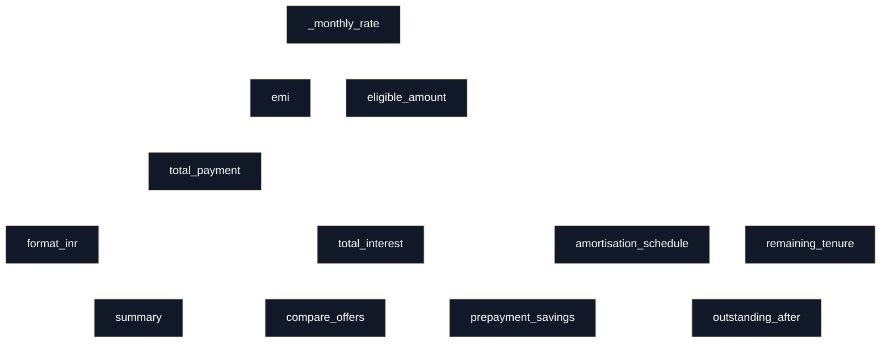

# loan-calc — Architecture

## Overview

`loan-calc` is a small Python module that computes common retail-loan metrics:

- EMI (Equated Monthly Instalment)
- Total payment and total interest
- Amortisation schedule (month-by-month split of interest vs principal)
- Outstanding balance after N months
- Lump-sum prepayment savings (keep EMI fixed, reduce tenure)
- Offer comparison
- Eligibility amount based on income/FOIR
- INR currency formatting
- Schedule export to CSV
- A `summary()` helper used by the CLI to format key outputs

Primary entry points (as used by `loan-calc/cli.py`):
- `summary(principal, annual_rate, tenure_months)`
- `amortisation_schedule(principal, annual_rate, tenure_months)`
- `prepayment_savings(principal, annual_rate, tenure_months, prepay_month, prepay_amount)`

The package `loan_calc/__init__.py` re-exports `calculator.py` functions (`from .calculator import *`), so callers can import directly from `loan_calc`.

## Module / function map (call diagram)

## Key formulas

### Monthly rate
Intended (standard) monthly rate:

- `r = annual_rate / 12 / 100 = annual_rate / 1200`

Current code applies rounding:

- `r = round(annual_rate / 1200, 4)` (see `_monthly_rate()`)

### EMI (standard amortising loan)

For principal `P`, monthly rate `r`, tenure `n` months:

- If `r > 0`:

  `EMI = P * r * (1 + r)^n / ((1 + r)^n - 1)`

- If `r = 0`:

  `EMI = P / n`

This is implemented in `emi()`.

## Rounding conventions (as implemented today)

This module mixes rounding at different steps:

- `_monthly_rate()` rounds monthly rate `r` to **4 decimal places**.
- `emi()` returns EMI rounded to **2 decimal places**.
- `amortisation_schedule()` rounds per-month:
  - interest = `round(balance * r, 2)`
  - principal component = `round(emi - interest, 2)`
  - balance = `round(balance - principal_component, 2)`
- Outputs in `summary()` are formatted into strings via `format_inr()` which rounds to 2 decimals and adds the ₹ symbol and Indian grouping commas.

These conventions materially affect invariants like “sum of principal components equals principal” (it may be off by a few paise/rupees due to per-month rounding).

## Per-function details (line-by-line cross-checked)

### `DEFAULT_CURRENCY: str`
- Constant string `"INR"`.
- Used in `summary()` under key `"currency"`.

### `_monthly_rate(annual_rate)`
**Signature:** `_monthly_rate(annual_rate)`  
**Purpose:** Convert annual percentage rate to a monthly fractional rate.  
**Inputs:**
- `annual_rate`: assumed to be an annual nominal interest rate in percent (e.g. 9 for 9% p.a.).  
**Outputs:**
- Returns `r = round(annual_rate / 1200, 4)`.
**Side effects:** none.

### `emi(principal, annual_rate, tenure_months)`
**Signature:** `emi(principal, annual_rate, tenure_months)`  
**Purpose:** Compute the monthly EMI for a loan.  
**Inputs:**
- `principal`: loan amount (must be > 0, else `ValueError`)
- `annual_rate`: annual rate in percent (no explicit validation; negative rates are technically accepted by code path)
- `tenure_months`: months (must be > 0, else `ValueError`)
**Outputs:**
- Monthly payment (float) rounded to 2 decimals.
**Formula:**
- Uses `_monthly_rate(annual_rate)` for `r`.
- If `r == 0`: returns `round(principal / tenure_months, 2)`.
- Else computes factor `f = (1 + r) ** tenure_months` and returns:
  `round(principal * r * f / (f - 1), 2)`

### `total_payment(principal, annual_rate, tenure_months)`
**Signature:** `total_payment(principal, annual_rate, tenure_months)`  
**Purpose:** Total amount paid over the full tenure using fixed EMI.  
**Inputs:** same as `emi()`.  
**Outputs:**
- `round(emi(...) * tenure_months, 2)`.

### `total_interest(principal, annual_rate, tenure_months)`
**Signature:** `total_interest(principal, annual_rate, tenure_months)`  
**Purpose:** Total interest paid over the full tenure using fixed EMI.  
**Outputs:**
- `round(total_payment(...) - principal, 2)`.

### `amortisation_schedule(principal, annual_rate, tenure_months)`
**Signature:** `amortisation_schedule(principal, annual_rate, tenure_months)`  
**Purpose:** Produce a month-by-month amortisation breakdown.  
**Inputs:** principal, annual_rate (%), tenure_months.  
**Outputs:**
- List of dict rows with keys:
  - `month` (int)
  - `emi` (float)
  - `interest` (float)
  - `principal` (float)
  - `balance` (float; clamped at minimum 0)
**Computation (as coded):**
- `r = _monthly_rate(annual_rate)`
- `instalment = emi(principal, annual_rate, tenure_months)`
- Starts `balance = principal`
- Iterates: `for month in range(1, tenure_months):`
  - interest = round(balance * r, 2)
  - principal_part = round(instalment - interest, 2)
  - If `month == tenure_months`: adjust last month to fully clear remaining balance (but see “Suspicious behaviour” below).
  - balance updated by subtracting principal_part (rounded to 2 decimals)
  - row appended with `balance: max(balance, 0.0)`

**Side effects:** none.

### `outstanding_after(principal, annual_rate, tenure_months, months_paid)`
**Purpose:** Return outstanding balance after a given number of EMIs have been paid.  
**Logic:**
- If `months_paid <= 0`: returns `round(principal, 2)`
- Else builds full schedule via `amortisation_schedule()`
- If `months_paid > len(sched)`: returns `0.0`
- Else returns `sched[months_paid - 1]["balance"]`

### `remaining_tenure(balance, annual_rate, instalment)`
**Purpose:** Compute number of months required to clear `balance` with fixed `instalment`.  
**Inputs:**
- `balance`: outstanding principal
- `annual_rate`: annual % (but see actual code behaviour)
- `instalment`: payment per month
**Outputs:** integer months (ceil).  
**Logic (as coded):**
- Sets `r = annual_rate / 100` (note: this is **annual fraction**, not monthly; see Suspicious behaviour).
- If balance <= 0: 0
- If r == 0: ceil(balance / instalment)
- If instalment <= balance * r: raise ValueError
- Else:
  `n = -log(1 - balance * r / instalment) / log(1 + r)`
  return ceil(n)

### `prepayment_savings(principal, annual_rate, tenure_months, prepay_month, prepay_amount)`
**Purpose:** Estimate savings if a lump-sum prepayment is made at `prepay_month`, while keeping EMI constant and shortening tenure.  
**Inputs:**
- principal, annual_rate, tenure_months: original loan
- prepay_month: month index (1-based expected by code’s `sched[prepay_month-1]`)
- prepay_amount: lump sum amount
**Outputs:** dict:
- `emi`
- `months_saved`
- `new_tenure`
- `interest_saved`
- `interest_paid_before_prepayment`

**Algorithm (as coded):**
- instalment = emi(...)
- sched = amortisation_schedule(...)
- balance at prepay month = `sched[prepay_month - 1]["balance"]`
- new_balance = balance - prepay_amount
- if new_balance <= 0: months_left = 0 else months_left = remaining_tenure(new_balance, annual_rate, instalment)
- original_left = tenure_months - prepay_month
- interest_paid_so_far = sum(interest rows up to prepay_month)
- original_interest = total_interest(principal, annual_rate, tenure_months)
- new_total = instalment * prepay_month + prepay_amount + instalment * months_left
- new_interest = new_total - principal
- interest_saved = round(original_interest - new_interest, 2)

### `compare_offers(principal, offers)`
**Purpose:** Compare different bank offers and sort by total cost.  
**Inputs:**
- `principal`
- `offers`: list of dicts with keys:
  - `bank`
  - `rate` (annual %)
  - `tenure` (months)
  - optional `processing_fee_pct`
**Outputs:**
- list of dicts containing:
  - bank, emi, total_interest, processing_fee, total_cost
- sorted ascending by `total_cost`
**Note:** `total_cost` is computed as `ti + fee` (interest + fee), not including principal; that’s fine as a comparison metric but should be documented as such.

### `eligible_amount(monthly_income, existing_emis, annual_rate, tenure_months, foir=0.5)`
**Purpose:** Compute maximum principal eligible based on available EMI capacity and tenure.  
**Inputs:**
- `monthly_income`
- `existing_emis`
- `annual_rate` (%)
- `tenure_months`
- `foir`: fraction of income allowed for EMIs (default 0.5)
**Algorithm:**
- available = monthly_income * foir - existing_emis
- if available <= 0: return 0.0
- r = _monthly_rate(annual_rate)
- if r == 0: eligible principal = round(available * tenure_months, 2)
- else uses inverse EMI formula:
  `P = available * (f - 1) / (r * f)` where `f = (1+r)^n`

### `format_inr(amount)`
**Purpose:** Format a numeric amount into a string with:
- rupee symbol `₹`
- Indian digit grouping (lakhs/crores style)
- 2 decimal places
- leading `-` for negatives  
**Side effects:** none.

### `schedule_to_csv(rows, path)`
**Purpose:** Write schedule rows to a CSV file.  
**Inputs:** `rows` as produced by `amortisation_schedule()`, file path.  
**Side effects:** Writes/overwrites the file at `path`.  
**Notes:** Opens without specifying encoding/newline.

### `summary(principal, annual_rate, tenure_months, start=None)`
**Purpose:** Produce a formatted summary dict for the CLI.  
**Inputs:**
- principal, annual_rate, tenure_months
- start: optional `date` (defaults to `date.today()`)
**Outputs:** dict with formatted strings:
- principal, rate, tenure, emi, total_interest, total_payment, last_emi, currency
**End date calc:**
- Computes end year/month by adding `tenure_months` to start month via integer division/mod.

## Suspicious behaviour (do not fix in Phase 1; likely bugs)

1. **Amortisation schedule length off-by-one**
   - Loop is `range(1, tenure_months)` which yields only `tenure_months - 1` rows.
   - The intended “last month” branch `if month == tenure_months:` is unreachable.
   - Consequences: schedule never includes final payoff row; balance may not reach 0; invariants likely fail.

2. **`remaining_tenure()` uses annual rate where monthly rate is required**
   - Uses `r = annual_rate / 100` directly in log formula.
   - If annual_rate = 9 (%), this sets r = 0.09 per period, but period is monthly instalments, so r should be monthly rate (~0.0075).
   - Consequences: drastically wrong remaining tenure after prepayment.

3. **Monthly rate rounding to 4 decimals may distort EMI and schedule**
   - `_monthly_rate()` rounds aggressively (`round(..., 4)`).
   - Over long tenures, this can shift EMI by multiple rupees and total interest by a lot.

4. **Prepayment month bounds not validated**
   - `sched[prepay_month - 1]` will:
     - pick wrong row if `prepay_month == 0` (Python negative index)
     - raise `IndexError` if `prepay_month > len(sched)`
   - The rest of the function assumes `prepay_month` is valid and 1-based.

5. **`outstanding_after()` depends on schedule length**
   - If schedule is missing final month, `months_paid > len(sched)` may return 0 early for legitimate inputs.

These items will be revisited during Phase 3/4 when tests identify failing behaviour.
